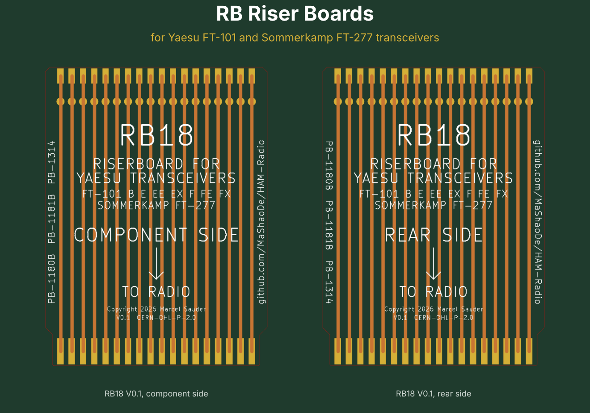

# RB Riser Boards for Yaesu FT-101 and Sommerkamp FT-277 Transceivers

*Because aligning a plug-in card with your nose inside the chassis is a tradition no OM or YL needs to keep.*

**No CAD skills needed, no special tools, no excuses.** Grab the Gerber ZIP, upload it to JLCPCB, order a card edge connector, and a week later the postman brings you a pack of shiny gold fingered boards. Heat up the iron, solder 36 joints, beep them through, and your FT-101 opens up like it never did before. That is the DIY spirit that built ham radio: you build it, you understand it, you fix it. Let's go!

The Yaesu FT-101 family, sold in Europe as the Sommerkamp FT-277, earned the nickname "the workhorse" for good reason: almost every circuit sits on a plug-in card that drops into an edge connector in the chassis. Great for service. Less great when you want to measure a card while it is running, because then it is buried between its neighbours.

A riser board solves that, QSL? It plugs into the socket in the radio, and the card plugs into the riser. The card now stands about 10 cm higher, in line with its original position, and every trimmer, test point and component is within reach of your probe. Each contact also gets its own test pad on the riser, top and bottom.

## Which radios?

Every model of the original series with plug-in cards:

| Brand | Models |
|---|---|
| Yaesu | FT-101 (Mk I, Mk II), FT-101B, FT-101E, FT-101EE, FT-101EX, FT-101F, FT-101FE, FT-101FX (plus the Japanese BS and ES versions) |
| Sommerkamp | FT-277, FT-277B, FT-277E, FT-277EE |

Not for the FT-101Z and FT-101ZD. Despite the name they are a different design without plug-in cards. Sorry, Z owners, negative copy on this one.

## Which riser for which card?

The number in the name is the count of contacts per side. That is also how to pick one: count the fingers on one side of your card, or measure the width of the finger zone.

| Riser | Contacts | Finger zone | Cards | Status |
|---|---|---|---|---|
| [RB10](hardware/riser-2x10) | 2x10 | 42 mm | PB-1292 noise blanker | V0.1 Gerber ready, untested |
| [RB14](hardware/riser-2x14) | 2x14 | 57 mm | PB-1184A modulator and oscillator | V0.1 Gerber ready, untested |
| [RB18](hardware/riser-2x18) | 2x18 | 73 mm | PB-1180B HF IF, PB-1181B RF, PB-1314 regulator | **V0.1 prototype ordered** |
| [RB22](hardware/riser-2x22) | 2x22 | 89 mm | PB-1183B IF, PB-1315A AF | V0.1 Gerber ready, untested |

Card names vary between production runs. If your card has the right width, it fits.

## Build one in four steps

1. **Download** the Gerber ZIP of your riser: [RB10](hardware/riser-2x10/RB10_V0.1_gerber.zip), [RB14](hardware/riser-2x14/RB14_V0.1_gerber.zip), [RB18](hardware/riser-2x18/RB18_V0.1_gerber.zip) or [RB22](hardware/riser-2x22/RB22_V0.1_gerber.zip).
2. **Order** bare boards at JLCPCB or a similar maker. Settings are in [docs/ordering.md](docs/ordering.md). The one thing you must not forget: **Gold Fingers: Yes**.
3. **Buy** one card edge connector per board, see [docs/bom.md](docs/bom.md).
4. **Solder** the connector and start measuring, see [docs/assembly.md](docs/assembly.md).

Total cost for five RB18 boards plus connectors: roughly the price of a nice dinner for two, and a lot less than a burnt card. Share the spare boards with the OMs in your club and the whole local net is QRV for service.

## What is on the board

- FR4, 1.6 mm, 105 mm long, in-line design: the card stands straight above the socket
- Hard gold edge fingers on both sides with a bevelled tip
- 2 mm traces, top and bottom kept separate, all covered by solder mask
- One test pad per contact on both sides, in line with the card's pins
- Clear silkscreen: riser type, compatible radios, "COMPONENT SIDE" and an arrow towards the radio, so the card goes in the right way round
- No pin numbers printed. The cards in this family number their pins in different directions, so the riser would be wrong on half of them. Read the number on the card itself.

## A word about RF and IF cards

The riser makes the signal path about 10 cm longer. Supply voltages, bias and audio do not care. Tuned RF and IF circuits (PB-1180B, PB-1181B, PB-1183B) may, and you would rather not hunt self-made QRM. Use the riser there to measure voltages and levels, and do the fine alignment with the card back in its own socket.

## Contents

- [docs/specification.md](docs/specification.md): measurements, design decisions, open questions
- [docs/ordering.md](docs/ordering.md): Gerber export and order settings
- [docs/bom.md](docs/bom.md): parts to buy
- [docs/assembly.md](docs/assembly.md): soldering, checking and using the riser
- `hardware/`: one folder per riser with KiCad board, Gerber files and pictures
- `hardware/tools/gen_riser.py`: generator for all variants (`python3 gen_riser.py 10|14|18|22`)

## Licenses

- Hardware (KiCad files, Gerber files, generator): CERN-OHL-P-2.0
- Documentation and pictures: CC-BY-4.0

See [LICENSE.md](LICENSE.md). You may build, sell and modify the boards. If you change the design, please give it a name of your own and do not call it RB10, RB14, RB18 or RB22, so that the tested original stays recognisable.

## Disclaimer

Use at your own risk. The FT-101 carries high voltages in the PA section, and the riser does not change that. This project has no connection to Yaesu or Sommerkamp. The names are used only to state compatibility.

## Contributing

Measurements of other cards, corrections, photos and stories of successful repairs are welcome. Open an issue or a pull request, we copy you 5 and 9.

Questions, ideas or wishes for changes? Just call in by opening an issue on GitHub. No promises on what gets built or when, this is a hobby project run in spare time between QSOs, but every message is read and the band is always open.

## Thank you

To Yaesu for building a radio that people still repair with love fifty years later, to Sommerkamp for bringing it to Europe, to everyone who keeps the service manuals and board lists online, and to every OM and YL who keeps an old workhorse on the air.

May your filaments glow and your SWR stay flat.

73 de Marcel (MaShaoDe)

Copyright 2026 FerienBSD aka Marcel Sauder (MaShaoDe)
