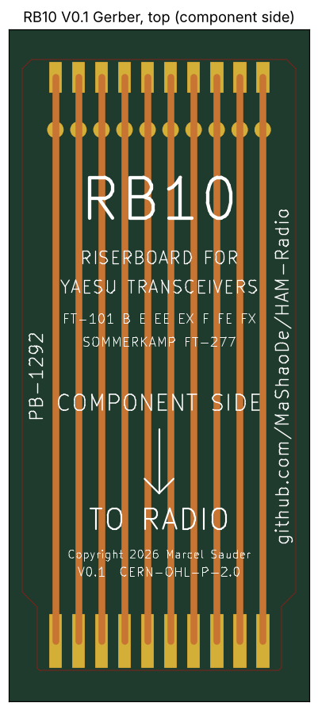
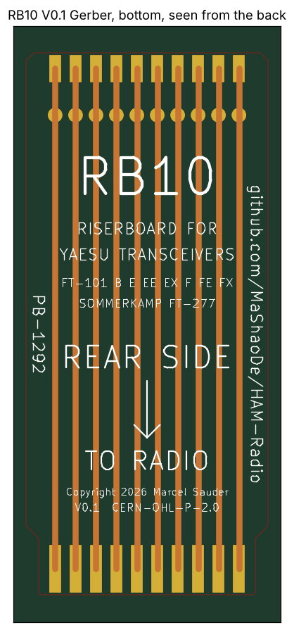

# RB10: Riser 2x10 (20 contacts)

Status: V0.1, Gerber files exported from KiCad 9. Same design rules as the RB18. Will be ordered after the RB18 prototype has passed its test.

For cards: PB-1292 (noise blanker)

| Component side | Rear side |
|---|---|
|  |  |

## Files

| File | Content |
|---|---|
| `riser-2x10.kicad_pcb` | KiCad board (KiCad 8 format, opens in KiCad 9) |
| `RB10_V0.1_gerber.zip` | Gerber and drill files, ready to upload to the PCB maker |
| `gerber/` | The same Gerber files, unpacked |
| `gerber-front.png`, `gerber-back.png` | Rendered from the Gerber files |
| `preview.png` | Quick preview from the generator |
| `riser-2x10_V0.2.kicad_pcb`, `preview_V0.2.png` | V0.2 (new silkscreen, see CHANGELOG), Gerber files pending |
| `../tools/gen_riser.py` | Generator. `python3 gen_riser.py 10` rebuilds both files. |

## Board

| Item | Value |
|---|---|
| Material | FR4, 1.6 mm, 2 layers, 1 oz |
| Length | 105 mm (finger tip to connector edge) |
| Finger zone | 11 mm long, 42 mm wide |
| Upper part | 47 mm wide, 45 degree step, rounded corners (R 1.5 mm) |
| Contact pitch | 3.96 mm, contact field 35.64 mm |
| Edge fingers | 2.0 x 9.0 mm, 0.6 mm back from the tip, both sides, hard gold |
| Traces | 2.0 mm, straight, top and bottom separate |
| Test pads | round 2.6 mm, 12 mm from the connector edge, both sides |
| Connector pads | 2.0 x 5.0 mm, 0.5 mm from the connector edge, both sides |
| Silkscreen | centre texts scaled to the board width |

## Ordering and assembly

- Order settings: [../../docs/ordering.md](../../docs/ordering.md)
- Connector (20 contacts, 3.96 mm): [../../docs/bom.md](../../docs/bom.md)
- Soldering and use: [../../docs/assembly.md](../../docs/assembly.md)

## Revision history

| Version | Date | Change |
|---|---|---|
| V0.1 | 2026-11-11 | First layout, generated with the RB18 rules, Gerber exported |
