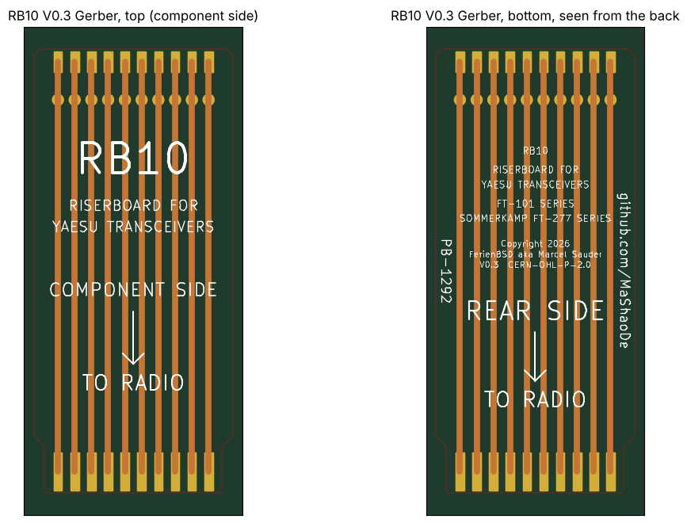

# RB10: Riser 2x10 (20 contacts)

For cards: PB-1292 (noise blanker)

Current version: **V0.3**, in production since 2026-11-25.

## Files

| File | Content |
|---|---|
| [`RB10_V0.3_gerber.zip`](RB10_V0.3_gerber.zip) | Gerber and drill files, ready to upload to any PCB maker |
| `RB10_V0.3.png` | Both sides, rendered from the Gerber files |

## Board

| Item | Value |
|---|---|
| Outline | 47 x 105 mm (finger zone 42 mm wide, 11 mm long) |
| Contacts | 2x10, pitch 3.96 mm, contact field 35.64 mm |
| Edge fingers | 2.0 x 9.0 mm, both sides |
| Test pads | round 2.6 mm, both sides, one per contact |
| Connector pads | 2.0 x 5.0 mm, both sides |

Fabrication settings: [../../docs/ordering.md](../../docs/ordering.md). Connector: [../../docs/bom.md](../../docs/bom.md). Soldering and use: [../../docs/assembly.md](../../docs/assembly.md).
