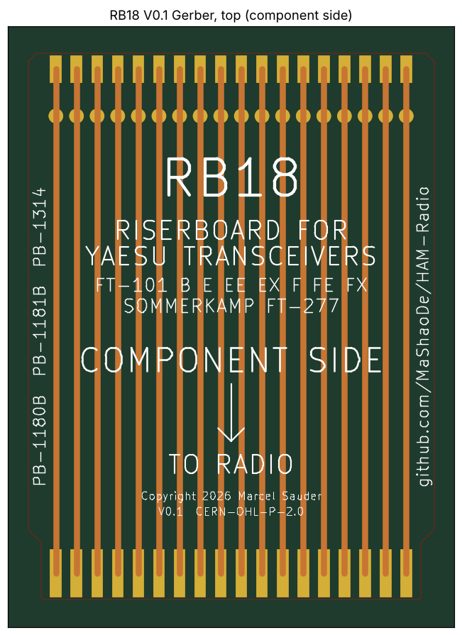
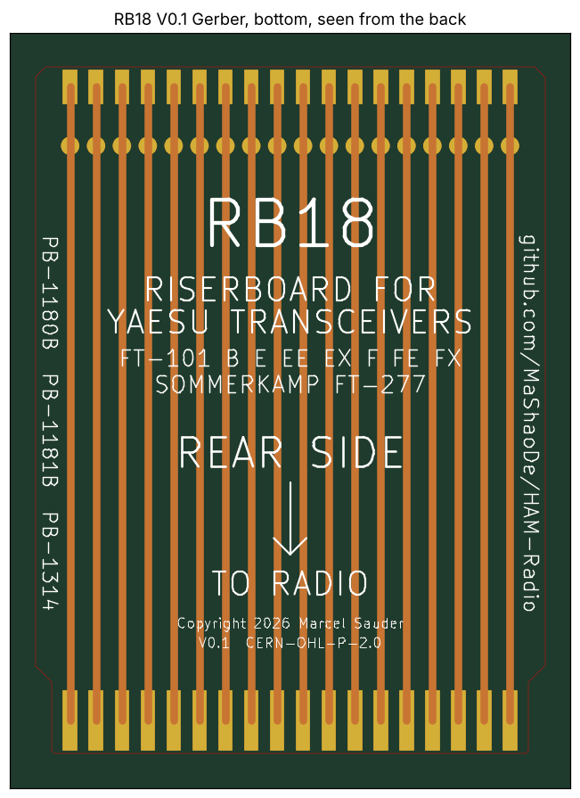

# RB18: Riser 2x18 (36 contacts)

Status: V0.1, DRC clean in KiCad 9.0.7, Gerber files exported. 5 prototypes ordered on 2026-11-11, test pending.

For cards: PB-1180B (HF IF), PB-1181B (RF amplifier), PB-1314 (regulator)

| Component side | Rear side |
|---|---|
|  |  |

## Files

| File | Content |
|---|---|
| `riser-2x18.kicad_pcb` | KiCad board (KiCad 8 format, opens in KiCad 9) |
| `RB18_V0.1_gerber.zip` | Gerber and drill files, ready to upload to the PCB maker |
| `gerber/` | The same Gerber files, unpacked |
| `gerber-front.png`, `gerber-back.png` | Rendered from the Gerber files |
| `preview.png` | Quick preview from the generator |
| `riser-2x18_V0.2.kicad_pcb`, `preview_V0.2.png` | V0.2 (new silkscreen, see CHANGELOG), Gerber files pending |
| `../tools/gen_riser.py` | Generator. `python3 gen_riser.py 18` rebuilds the board file and `preview.png`. |

## Board

| Item | Value |
|---|---|
| Material | FR4, 1.6 mm, 2 layers, 1 oz |
| Length | 105 mm (finger tip to connector edge) |
| Finger zone | 11 mm long, 73 mm wide |
| Upper part | 78 mm wide, 45 degree step, rounded corners (R 1.5 mm) |
| Contact pitch | 3.96 mm, contact field 67.32 mm |
| Edge fingers | 2.0 x 9.0 mm, 0.6 mm back from the tip, both sides, hard gold |
| Traces | 2.0 mm, straight, top and bottom separate (nets POS01F, POS01B ...) |
| Test pads | round 2.6 mm, 12 mm from the connector edge, both sides |
| Connector pads | 2.0 x 5.0 mm, 0.5 mm from the connector edge, both sides |
| Solder mask | both sides over all traces, open only at fingers, test pads and connector pads |
| Silkscreen | both sides, white |

## Ordering and assembly

- Order settings: [../../docs/ordering.md](../../docs/ordering.md)
- Connector and soldering: [../../docs/assembly.md](../../docs/assembly.md)

## Revision history

| Version | Date | Change |
|---|---|---|
| V0.1 | 2026-11-11 | First layout, DRC clean, Gerber exported |
